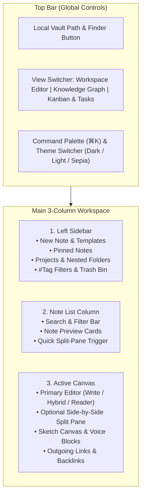

# NoteFlow Studio — Complete User Guide

Welcome to **NoteFlow Studio**, your local-first desktop workspace for writing in any style, organizing across **Projects, Nested Folders, and `#Tags`**, and visualizing your connected ideas.



---

## 1. Choosing Your Local Vault Folder on Mac

All of your notes belong to you and are stored as real folders and clean Markdown (`.md`) files on your Mac.

1. **Change Your Local Storage Location:**
   - Click the **Vault Folder path** pill in the top-left bar (or the **Local Vault Folder** card at the bottom of the left sidebar).
   - Select any directory on your Mac using the native macOS folder picker and click **"Use This Folder for Notes"**.
2. **View Files in macOS Finder:**
   - Click the **Finder** button right next to the vault path in the top bar to open your vault directory in Finder.
   - Inside, you will see your exact **Project folders**, **Nested subfolders**, and **`.md` note files** (complete with YAML frontmatter for tags, status, and metadata).

> [!TIP]
> Every edit you make is **automatically saved and synced** to your local folder within milliseconds—look for the green **`✓ Synced locally`** indicator in the top bar.

---

## 2. Tri-Layer Organization: Projects, Folders & `#Tags`

You never have to choose between strict folder hierarchies and fluid tags—NoteFlow Studio gives you both simultaneously:

### A. Projects (High-Level Workspaces)
- **Create a Project:** In the left sidebar next to **PROJECTS & FOLDERS**, click the **`+`** button, type a project name (e.g., *Startup Launch*), and press `Enter`.
- **Switch Projects:** Click any project in the sidebar to view only the notes inside that workspace.

### B. Nested Folders & Subfolders
- **Create a Root Folder:** Hover over any Project in the sidebar and click the **Folder `+` icon** that appears on the right.
- **Create a Nested Subfolder:** Hover over an existing Folder and click its **`+` icon** to nest a subfolder inside it (`↳ Subfolder`).
- **Move a Note Between Projects or Folders:** At the very top-left of any open note, use the **Project dropdown** and **Folder dropdown** to reassign the note's location at any time.

### C. Multi-Tagging (`#tags`)
- **Add Tags in the Note Header:** Click **`+ Add Tag`** right below the note title, type a tag name (e.g., `urgent` or `architecture`), and press `Enter`.
- **Add Tags Inline While Typing:** Type `#tag-name` followed by a space anywhere in the note editor—NoteFlow automatically detects the tag and attaches it to the note!
- **Filter by Tag:** Click any `#tag` pill in the left sidebar under **FILTER BY #TAGS** to filter notes across all projects and folders.

### D. Pinned Notes & Templates
- **Pin Important Notes:** Click the **Pin icon** in the top-right toolbar of any note to pin it to the **PINNED NOTES** section at the top of your sidebar.
- **Use 1-Click Templates:** Click the **Template icon** right next to the **New Note** button in the sidebar to start from a pre-built *Meeting Notes*, *Project Brief / Spec*, or *Daily Journal* template.

---

## 3. Writing in Any Style (Hybrid Editor)

Every note can be tailored to how you think and write best using the controls in the top-right bar of the editor:

| Control | Options | Best For |
| :--- | :--- | :--- |
| **Editor Mode** | **Write** / **Hybrid** / **Reader** | **Write**: Pure distraction-free Markdown.<br>**Hybrid**: Write Markdown on top with live interactive checkboxes & clickable links below.<br>**Reader**: Clean formatted reading view. |
| **Note Layout** | **Document** / **Wide** / **Cards** | **Document**: Classic centered essay width.<br>**Wide**: Full-width canvas for tables & sketches.<br>**Cards**: Framed card layout. |
| **Typography** | **Sans** / **Serif** / **Mono** | Switch between modern *Inter* (Sans), book-style *Georgia* (Serif), or technical *JetBrains Mono*. |

---

## 4. Slash (`/`) Commands & Formatting

You can insert rich blocks without taking your hands off the keyboard:

1. **Using the Slash (`/`) Menu:**
   - Type **`/`** on a new line (or after a space) to open the interactive **Slash Command Menu**.
   - Type to filter (e.g., `/todo`, `/table`, `/draw`, `/voice`, `/code`, `/callout`) and press **Click** to insert the block.
2. **Using the Quick Formatting Bar:**
   - Above the editor, click any icon to insert **Bold**, **Italic**, **H1/H2**, **Bullet Lists**, **Checklists (`- [ ]`)**, **Callout Boxes (`> [!TIP]`)**, **Code Blocks**, **Markdown Tables**, or **`[[Link Note]]`**.

> [!NOTE]
> **Callout Boxes:** Start a line with `> [!TIP]`, `> [!IMPORTANT]`, or `> [!NOTE]` to render highlighted alert boxes in Hybrid and Reader views.

---

## 5. Freehand Sketch Canvas & Voice Memos

### A. Inline Sketch / Drawing Canvas
1. Click **`+ Sketch Canvas`** in the editor toolbar (or type `/draw`).
2. Use the canvas toolbar to switch between **Pen**, **Highlighter**, and **Eraser**.
3. Pick from **8 colors**, adjust the **stroke width slider**, **Undo** strokes, **Clear** the canvas, or click the **Download icon** to save your sketch as a `.png` image.
4. Rename your sketch right in the block header—every stroke is auto-saved into the note.

### B. Inline Voice Memo Recorder
1. Click **`+ Voice Memo`** in the editor toolbar (or type `/voice`).
2. Click **Record Voice Note** to record audio from your microphone with a live animated waveform visualizer.
3. Click **Stop** when finished, then press the **Play/Pause** button anytime to listen back inside your note.

---

## 6. Connecting Notes: `[[Wiki-Links]]` & Knowledge Graph

### A. Bi-Directional `[[Wiki-Links]]` & Backlinks
1. **Link to an Existing Note:** Type **`[[`** anywhere in your note (or click **`[[Link Note]]`** in the toolbar) to open a searchable list of all notes in your vault. Click a note to insert `[[Note Title]]`.
2. **Create a New Note on the Fly:** Type `[[New Idea Name]]` for a note that doesn't exist yet—clicking the amber link badge in Hybrid/Reader mode will automatically create and open that note!
3. **Explore Connections:** Scroll to the bottom of any note to inspect:
   - **Outgoing Links:** All notes referenced by the current note.
   - **Backlinks / Referenced By:** Every note in your vault that links back to the current note.

### B. Interactive Knowledge Graph View
1. Click **Knowledge Graph** in the top-center navigation bar.
2. **Explore Connections:**
   - **Solid lines** represent direct `[[Wiki-Links]]` between notes.
   - **Dashed lines** represent shared `#tags`.
3. **Interact:**
   - Hover over any node to preview the note's content and open it.
   - **Click** any note node to jump straight to it in the editor.
   - **`Shift + Click`** any note node to open it in the **Side-by-Side Split Pane**.
   - Filter the graph by **Project**, toggle **`#Tags`** visibility, or use the **Zoom controls**.

---

## 7. Kanban Board & Action Items Hub

Click **Kanban & Tasks** in the top-center bar to manage your work in two ways:

1. **Note Workflow Board:**
   - View notes organized across 5 workflow columns: **Backlog**, **To Do**, **In Progress**, **In Review**, and **Done**.
   - **Drag and drop** note cards between columns (or use the quick `Move to:` buttons at the bottom of each card), or click **`+`** on any column header to create a note directly in that stage.
2. **All Note Checklists (Synced Action Items):**
   - Click the **All Note Checklists** tab in the Kanban header.
   - Every `- [ ]` and `- [x]` task written inside any of your notes is automatically aggregated here.
   - **Two-Way Sync:** Checking off a task here immediately updates the `- [x]` checkbox inside the original note!

---

## 8. Power-User Features & Shortcuts

### Side-by-Side Split-Pane View
- Click the **Split Columns icon** (`Columns`) in the top-right of the note editor (or hover over any note in the note list and click the Split icon) to open a **second note side-by-side**.
- Click **Close Split** in the right-hand pane whenever you want to return to a single canvas.

### Quick Capture Scratchpad
- Click the floating **Scratchpad** button in the bottom-right corner of the screen to jot down a quick thought, snippet, or reminder without leaving your current view.
- Select a target Project and click **Promote to Note** whenever you want to turn your scratchpad text into a permanent note.

### Exporting Notes (`.md`, `.html`, `.pdf`)
- Click the **Download / Export icon** in the top-right of any note to export it as:
  - **Markdown (`.md`)** with YAML frontmatter
  - **Standalone Web Page (`.html`)**
  - **Print / Save as PDF (`.pdf`)**

---

## 9. Keyboard & Markdown Cheat Sheet

| Shortcut / Syntax | Action |
| :--- | :--- |
| `Cmd / Ctrl + K` | Open the **Command Palette** (instant search, jump to note, run commands) |
| `Cmd / Ctrl + \` | Toggle **Focus / Zen Mode** (hides sidebars for distraction-free writing) |
| `Cmd / Ctrl + N` | Create a **New Note** in the current project & folder |
| `Shift + Enter` (in `Cmd+K`) | Open the selected note in the **Side-by-Side Split Pane** |
| `/` (inside editor) | Open the **Slash Command Menu** to insert blocks, canvas, or voice notes |
| `[[` (inside editor) | Open the **Wiki-Link Picker** to link to another note |
| `#tagname ` (with space) | Automatically attach `#tagname` to the current note |
| `- [ ] Task text` | Create an interactive checkbox synced with the **Kanban Action Items Hub** |
| `> [!TIP] Your text` | Create a highlighted Callout Box |

---

## 10. Running & Testing the App from Terminal

Whenever you want to launch or test the app from your project folder (`/Users/bishalbhowmik/Project/Note Taking app`):

```bash
# Start the Desktop App (Vite + Electron)
npm run dev

# Run the Automated Test Suite (Vitest)
npm test

# Build for Production
npm run build
```
